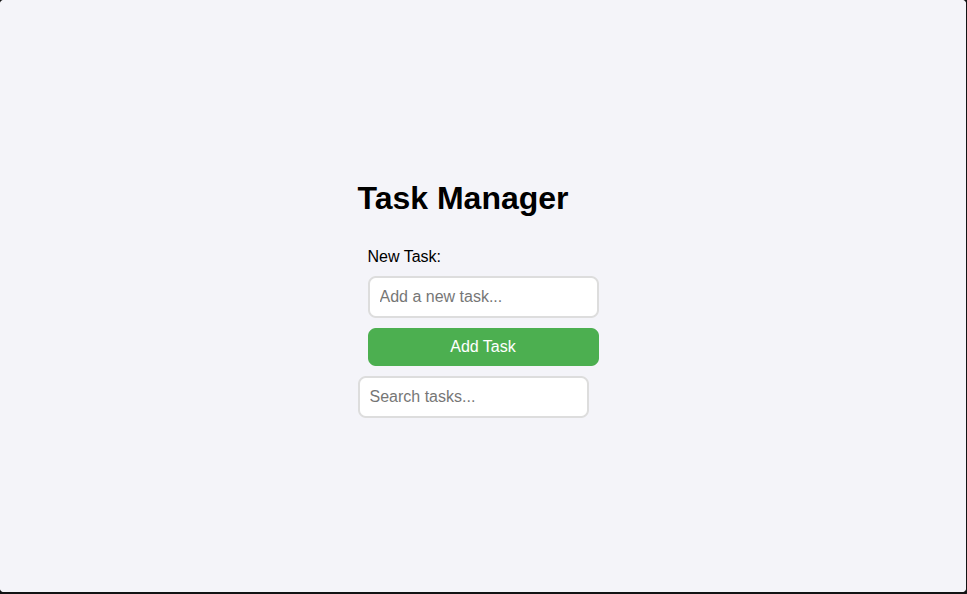

# Task Manager

A React application for organizing and tracking daily tasks. Users can add new tasks, mark existing tasks as completed, and search through their task list in real time using standard React hooks (`useContext`, `useId`, and `useRef`).

## Screenshot



## Features

- **Global State Management (`useContext`):** Uses `TaskContext` and `TaskProvider` to share tasks and state-updating functions across components without prop drilling.
- **Add New Tasks (`useId` & `POST`):** Generates unique, accessible form IDs with `useId` and persists newly submitted tasks to the local JSON server.
- **Toggle Task Completion (`PATCH`):** Allows users to mark tasks as complete or incomplete, updating both the UI and `db.json`.
- **Dynamic Task Search (`useRef`):** Tracks search input values directly with `useRef` to filter displayed tasks dynamically.

## Technologies Used

- React (`useContext`, `useId`, `useRef`, `useState`, `useEffect`)
- Vite
- JSON Server (REST API)
- JavaScript (ES6+ Fetch API)

## Getting Started

### Prerequisites

- Node.js and npm installed on your machine.

### Installation & Local Setup

1. Clone the repository:
   ```bash
   git clone https://github.com<your-task-manager-repo-name>.git
   ```
2. Navigate to the project directory:
   ```bash
   cd <your-task-manager-repo-name>
   ```
3. Install dependencies:
   ```bash
   npm install
   ```
4. Start the JSON server backend:
   ```bash
   npm run server
   ```
5. In a separate terminal, start the React development server:
   ```bash
   npm run dev
   ```

### Running Tests

To run the automated test suite:

```bash
npm run test
```